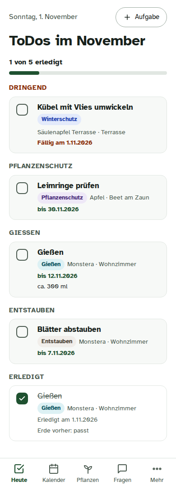
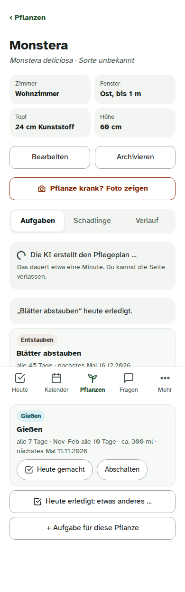
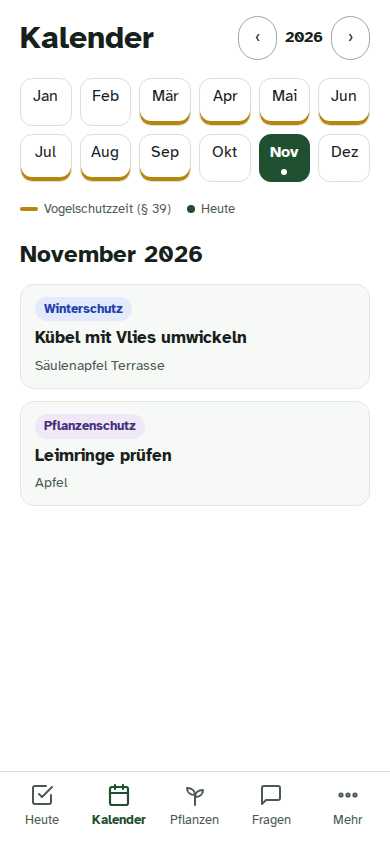

# Blattwerk

A self-hosted plant planner for a household, for the garden **and** the indoor plants (German UI, made for
phones). You keep a list of your plants, down to the cultivar. An AI (Claude) writes a care plan for each one,
the app turns it into to-dos you tick off, and the dates follow the real season instead of a fixed calendar.

<p>
  
  
  
</p>

## What it does

- **Plants and places.** Standorte outside (beds, hedge, tubs, greenhouse) and rooms inside (with the directions
  their windows face). Names in German or Latin, typos and trade names welcome; unknown ones are looked up by the
  AI, or identified **from a photo**.
- **Care plans.** Per plant: pruning with timing and method, fertilising with product examples, harvest windows,
  winter protection, typical pests with prevention and treatment. Indoor plants get a watering rhythm (summer and
  winter) and amount from pot and plant size, misting, dusting, repotting.
- **To-dos.** A monthly checklist for the household, done/skip/postpone with notes, a calendar for the garden,
  "heute gemacht" on a plant restarts its rhythm. After watering, "how was the soil?" lengthens or shortens the
  rhythm; "still moist, later" checks again in a few days.
- **The real season.** Garden dates can follow the phenological calendar of the German weather service (DWD), e.g.
  "prune the roses when the forsythia blooms" in your region, or your own observation.
- **Weather.** DWD MOSMIX forecast (and optionally your own sensors from Home Assistant): push alerts before frost,
  late frost on blossom, heat and storm, with concrete actions per plant and its hardiness.
- **German law in code.** Strong cuts on woody plants only from 1 October to end of February (§ 39 BNatSchG,
  bird protection); the rules move or block to-dos, whatever the AI suggested.
- **Ask and plant doctor.** A chat that knows your plants, to-dos, weather and season. Show it up to three photos
  of a sick plant: it describes what it sees, asks back when unsure, and proposes a diagnosis and follow-up to-dos.
- **The AI only proposes.** Plans, tasks, notes and diagnoses from the chat become real only with your "Ja".

## How it is built

```
phone (PWA) ──HTTPS──> Traefik ──> web (nginx, static app + /api proxy)
                                     └─> api (FastAPI) ──> PostgreSQL
                                           worker ──> Claude Code CLI (care plans, names, chat + MCP tools)
                                                  └─> DWD (forecast, phenology), Open-Meteo, push services
                            wetterwacht (alerts) ──> InfluxDB <── Telegraf <── Home Assistant / Open-Meteo
```

Python 3.14 (FastAPI, SQLAlchemy 2, Alembic, psycopg 3), PostgreSQL 17, InfluxDB 3 Core + Telegraf,
React + TypeScript (Vite) as an installable web app with web push. Only the web container is reachable; the
database and InfluxDB sit on an internal network without a route out. The reasons behind the main choices are in
[docs/adr](docs/adr); the full documentation with diagrams is at
**https://klopfer-hello.github.io/blattwerk/** (built from [docs/](docs)).

## Run it yourself

See **[docs/self-hosting.md](docs/self-hosting.md)**: a Docker host, HTTPS in front (Traefik or your own proxy),
and a Claude Code token for the AI features. Images: `ghcr.io/klopfer-hello/blattwerk-web` and `-api`.

Blattwerk is built for one household in Germany: German texts, German law, DWD weather. It runs without the AI
and without weather, but it is most useful with both.

## Development

After cloning, run `bash scripts/setup-dev.sh` once. It turns on the repo's git hooks: every commit and push is
checked for personal data (private IPs, LAN host names, user paths, e-mail addresses, tokens) and for secrets
(gitleaks, through Docker).

- `bash scripts/test.sh` — api (ruff, mypy strict, pytest against a real PostgreSQL) and web build, all in Docker.
- `bash scripts/ui-smoke.sh` — every screen at phone and desktop sizes with Playwright and an invented demo garden.
- `bash scripts/plan-eval.sh` — care-plan and name quality against the real Claude, run in a deployed worker
  (about USD 0.5 per full run).

## License

[PolyForm Noncommercial 1.0.0](LICENSE). The Claude Code CLI is Anthropic's proprietary software: it is never part
of the images; the worker downloads the pinned version at runtime and checks its SHA-256.
