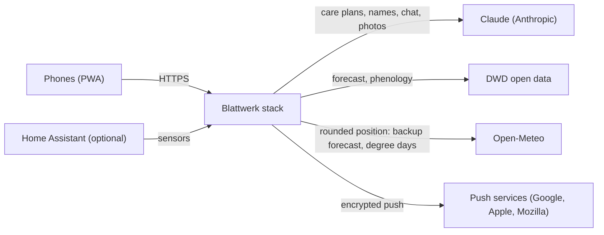
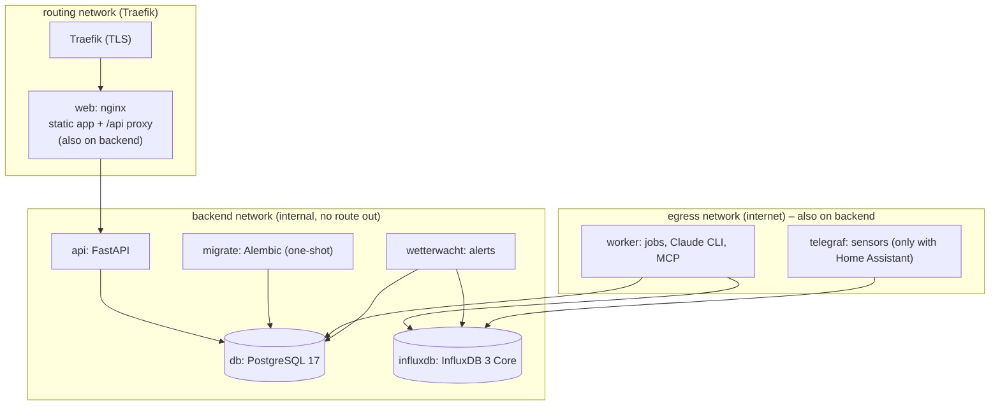
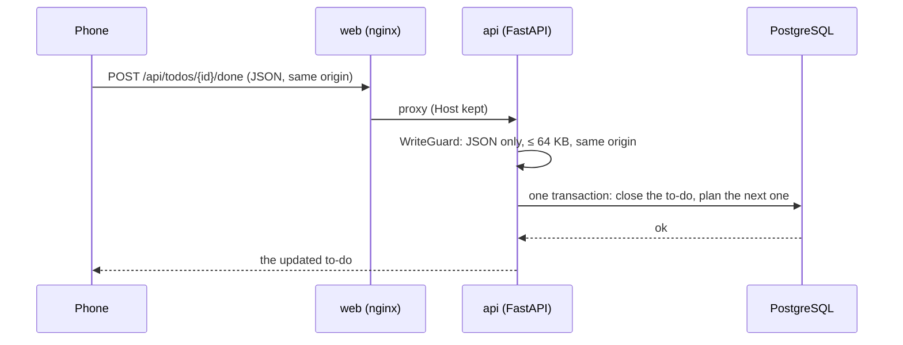
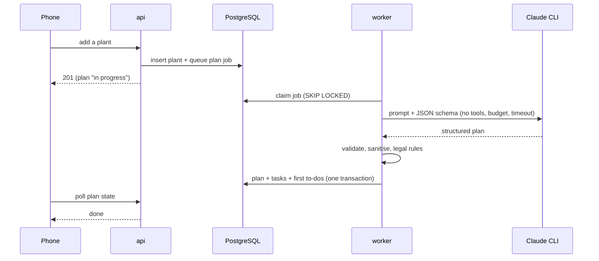
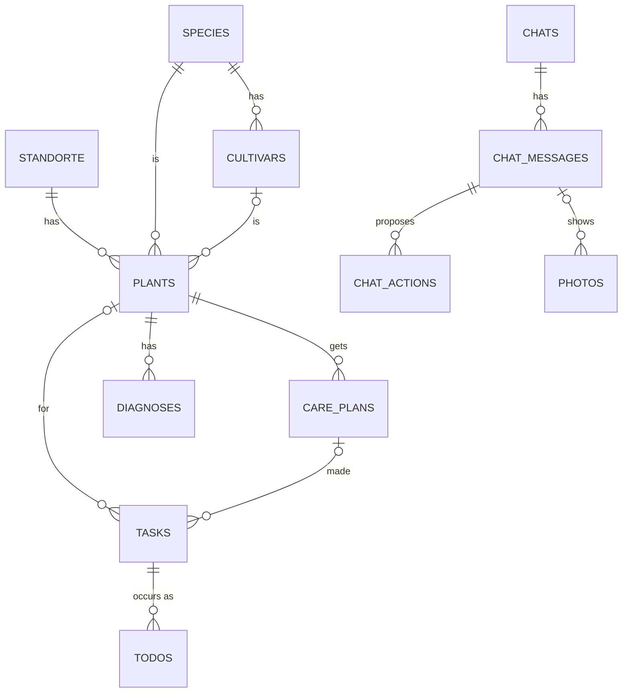
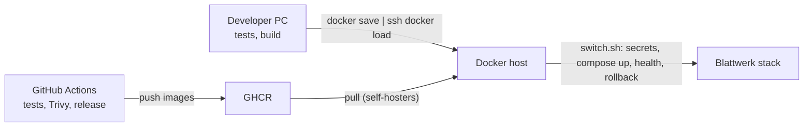

# Architecture

Blattwerk is one Docker Compose stack on one host in the home network. The phones talk to exactly one container;
everything else is internal.

## System context

## Containers and networks

- **Only `web` is reachable** (through Traefik). It serves the built React app and proxies `/api` to the API by
  container name, so nginx starts even while the API restarts.
- **`backend` is an internal network**: PostgreSQL, InfluxDB, the API and the migration job have no route to the
  internet and no published ports.
- **`worker` and `telegraf`** sit on `backend` and also join `egress`: the worker talks to Claude, DWD, Open-Meteo
  (growing degree days) and the push services; Telegraf to Home Assistant and Open-Meteo. `web` joins `backend` to
  reach the API. The API itself cannot reach the internet at all.
- **`migrate`** runs Alembic once before the API starts; the API only starts after it succeeded.
- All containers drop all capabilities (`cap_drop: [ALL]`) and run with `no-new-privileges`, read-only root
  filesystems where possible, and healthchecks. The app containers run as non-root users; the database gets back
  the five capabilities its entrypoint needs and then runs as the `postgres` user.

## Request flow: from tap to database

## Background work: the worker

The API never waits for the AI. It stores a **job** (care plan, name lookup, chat answer) and returns; the worker
claims jobs with `SELECT … FOR UPDATE SKIP LOCKED`, runs the Claude CLI, and writes the result in one transaction.
The phone polls (plans) or streams server-sent events (chat).

## Data model (core)

- **tasks** describe *what and when* (once, yearly month window, interval, optional season trigger);
  **todos** are the concrete occurrences on the checklist. See [the to-do engine](how-it-works/todo-engine.md).
- Care plans keep their history: a new plan *retires* the old tasks; done to-dos stay.
- Integrity lives in the database: foreign keys, CHECK constraints (e.g. `cut_type` only for pruning, an amount
  only for watering), unique keys that make job and to-do creation idempotent. Rules that depend on other rows
  (watering only for indoor plants) are enforced in the API where tasks and to-dos are made.

## Deployment

`deploy/switch.sh` does the same on every host: generate secrets that never leave it, start the stack, wait for
health, roll back to the previous images on failure. See [self-hosting](self-hosting.md).
