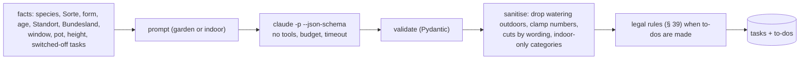

# The AI pipeline

Blattwerk uses Claude for four things: care plans, name lookups (and plant ID by photo), the plant doctor, and the
chat. All of them follow the same principle: **the model proposes, the code decides.**

## From plant to plan

- **Facts, not free text**: the prompt is a small JSON object of what the app knows about the plant (species,
  Sorte, form, age, Standort type and light or window, pot, height, Bundesland, preferences). Notes, nicknames and the
  place are never sent with a care plan.
- **Two prompts**: one for the garden (seasonal windows, phenology, pruning law), one for indoor plants (watering
  rhythm and amount, misting, dusting, repotting).
- **Structured output**: `--json-schema` makes the CLI return JSON of a fixed shape; Pydantic validates it again.
  Invalid tasks are dropped and counted; fields are normalised conservatively (a cut without `cut_type` counts as
  strong, a cut filed elsewhere becomes pruning, numbers are clamped, a bad season trigger is removed).
- **Switched-off tasks** go into the prompt as "do not suggest again", so a new plan does not bring them back under
  another name; the pause also carries over by title.

## Running the CLI safely

- Pinned version, SHA-256 verified, installed at runtime into a volume – never baked into an image.
- Every run: no built-in tools (`--tools ""`), no session persistence, `--permission-mode dontAsk`, a budget per
  call (`--max-budget-usd`) and a timeout.
- Daily limits per feature (plans, names, chat). A job that never reached Claude (e.g. token missing) does not count
  against the limit.
- Jobs are claimed with `FOR UPDATE SKIP LOCKED` and finished in one transaction; a stale job is failed with a clear
  German message after a timeout.

## Quality: /plan-eval

A fixed set of garden plants (hornbeam hedge, sweet cherry, columnar apple, rambler rose, Miscanthus, blueberry in a
pot, serviceberry) and indoor plants (pothos with a switched-off task, monstera, cactus, calathea, orchid) is run
through the real model with **deterministic checks**: strong cuts only October–February, harvest in the cultivar's
season, acidic fertiliser for blueberries, at least two brands per fertiliser, plausible watering intervals and
amounts, no misting for cacti, misting for calathea, no fertilising in winter, switched-off tasks stay away. Every
prompt change bumps `PROMPT_VERSION` and runs the eval.

## Why like this

LLM output is excellent horticultural knowledge with occasional confident mistakes. Treating it as *data* – typed,
validated, sanitised, constrained by rules – keeps the knowledge and removes the risk. The user stays in control:
plans can be edited, tasks switched off, and nothing from the chat happens without a "Ja".
