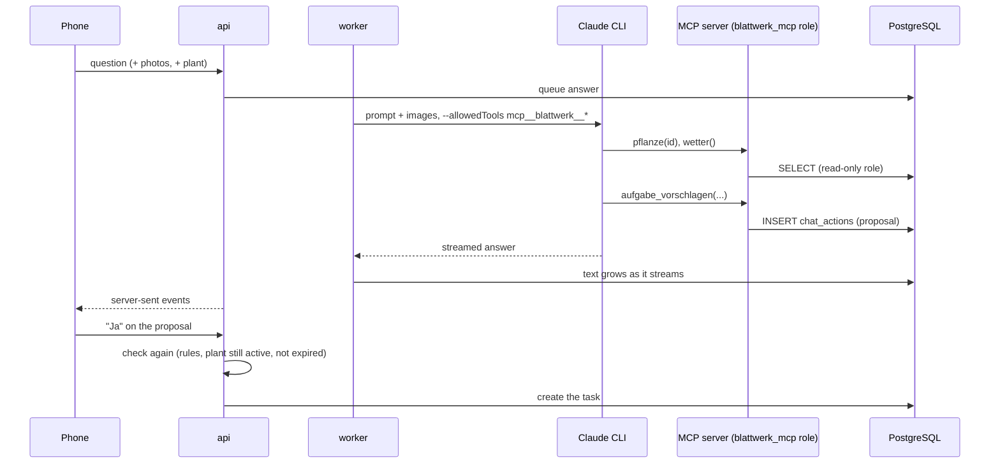

# Chat and MCP

"Fragen" is a chat about *this* household's plants. It answers from data, not from guesses.

## Tools instead of prompt stuffing

The worker runs the Claude CLI with exactly one MCP server (`blattwerk`, over stdio) and no other tools:

| Tool | Reads / does |
|---|---|
| `ueberblick` | Standorte (inside/outside) and plants with ids |
| `pflanze` | one plant: care plan, tasks, Sorte, form, age |
| `aufgaben` | this month's to-dos |
| `wetter` | measurements, forecast, active alerts |
| `jahreszeit` | the current phenological season and what comes next |
| `verlauf` | a plant's done to-dos and saved diagnoses |
| `aufgabe_vorschlagen`, `notiz_vorschlagen`, `diagnose_vorschlagen` | create a **proposal** |

The model calls the tools it needs for the question; the prompt stays small and the answer is grounded.

## Least privilege in the database

The MCP process connects as its own PostgreSQL role `blattwerk_mcp` with `SELECT` on the tables the tools need
and `INSERT` only on `chat_actions`. Even a manipulated answer cannot change a plant, delete a task or read
photos: the database refuses. Its password is generated on the host.

## Proposals, not actions

- At most five proposals per answer; duplicates are merged.
- A proposal is checked when it is made **and again** when you say "Ja" (dates, watering only indoors, the plant
  still exists); it expires after a week.
- Notes the user wrote on plants and to-dos are not given to the model.

## Why like this

A chat with write access is one prompt injection away from damage. Read-only tools plus explicit confirmation
keep the convenience of "lege mir das an" with none of the risk – and the database role makes that a property of
the system, not of the prompt.
