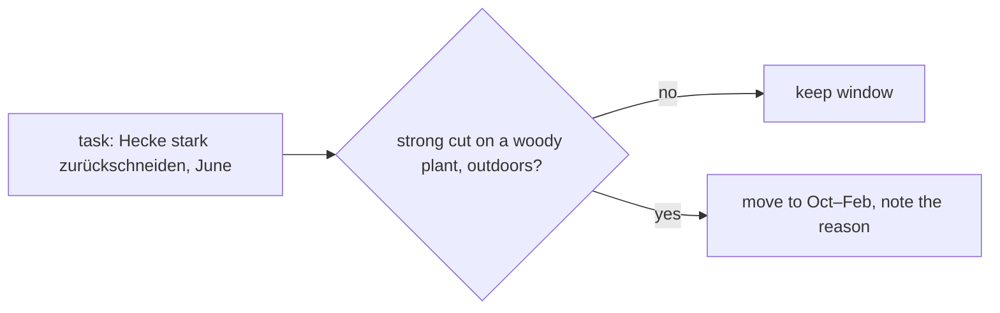

# German law in code

German nature-protection law limits garden work, and an AI does not reliably respect it. So the rules are code.

## § 39 BNatSchG: the bird-protection period

From **1 March to 30 September** it is forbidden to cut back hedges, shrubs and other woody plants strongly or to
put them "auf den Stock"; gentle shaping and care cuts (removing the year's growth) are allowed. Some
Bundesländer have their own dates; the rule uses the household's Bundesland.

How Blattwerk applies it:

1. Every pruning task has a `cut_type`: `pflege` (gentle) or `stark` (strong). The AI must set it; if it is
   missing, the task counts as **strong**. A task whose *wording* is a cut ("zurückschneiden", "auf den Stock
   setzen", "roden") becomes a pruning task even if the AI filed it elsewhere.
2. When a to-do is created, a strong cut's window is **moved** to the first allowed stretch, or after the closed
   period; the to-do carries the reason ("verschoben: 1.3.–30.9. kein radikaler Gehölzschnitt").
3. A strong cut that is open during the closed period is **blocked** until the first allowed day (not shown as
   overdue); postponing into the closed period is refused.
4. Notes explain the rule where it matters (bird nests must be checked even for gentle cuts, § 44).

Garden trees (fruit trees, by species and growth), plants indoors, and local tree bylaws (by trunk girth, a
household setting) are handled explicitly.

## Why rules are not prompts

- The prompt asks for correct timing, and the model is usually right – but "usually" is not enough for a rule
  with fines. Code is deterministic and tested.
- The same rule applies to tasks the user writes, edits and postpones, not only to AI output.
- The prompt stays shorter and the model can focus on horticulture.
