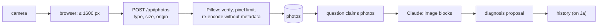

# Plant doctor and photos

## The flow

1. On a plant: **"Pflanze krank? Foto zeigen"** opens a chat about that plant.
2. Up to three photos (camera or gallery). The browser shrinks them to at most 1600 px as JPEG.
3. `POST /api/photos` – the only non-JSON route – takes the raw image: JPEG, PNG or WebP, at most 8 MB, same-origin.
4. The server verifies it with Pillow, refuses decompression bombs (pixel limit), and re-encodes a **fresh JPEG
   without any metadata** (no EXIF, no GPS, no camera data).
5. The question claims the photos; the worker sends them to Claude as image blocks with the question. A text-only
   follow-up ("seit einer Woche") still includes the latest photos.
6. Claude describes what it sees, asks back when unsure ("Blattunterseite?"), and only when fairly sure proposes a
   diagnosis with follow-up to-dos.
7. "Ja" saves the diagnosis with its photos in the plant's history.

## Limits and clean-up

- One photo belongs to exactly one question (atomic claim); a reused or unknown id is refused.
- At most 50 unsent uploads per day; unsent uploads are purged after a day; photos of deleted chats are purged
  unless a saved diagnosis uses them.
- The photo view is in-app (no new window that a home-screen app could not close).

## Why like this

Phone photos are personal data: GPS position, device, time. Stripping metadata on the **server** means it does not
depend on the client being well-behaved. Storing photos in PostgreSQL keeps backups and permissions in one place.
Asking back when unsure – instead of guessing a diagnosis – is part of the prompt and of the eval.
