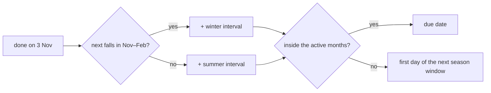

# The to-do engine

The checklist is the heart of the app. It has to be correct on several phones at once, survive plan changes, and
never lose history.

## Tasks and to-dos

A **task** says *what* and *when*; a **to-do** is one concrete occurrence of it on the checklist.

| Timing | Example | Occurrence key (`period`) |
|---|---|---|
| `once` | "Leimringe kaufen" on 5 Nov | `once` |
| `yearly` | "Rosen schneiden" March–April, or at forsythia blossom + 0 days | the year, e.g. `2027` |
| `interval` | "Gießen" every 7 days (Nov–Feb every 12) | the due date |

`materialize(day)` creates the to-dos that should exist on a given day (within a 60-day horizon). It is
**idempotent**: a unique key `(task, generation, period)` and `INSERT … ON CONFLICT DO NOTHING` make running it
twice – or on two phones at the same moment – harmless. It runs whenever Heute is read, a task changes, or a to-do
is closed. Task rows are share-locked meanwhile, so a concurrent edit cannot interleave.

## Intervals count from when you did it

An interval to-do is due *n* days after the previous one was **done or skipped**, not on a fixed grid. If you
water two days late, the next watering moves too. This single rule covers done, undo, pause/resume and interval
changes without special cases.

Indoor tasks add a **winter rhythm** (Nov–Feb) and **active months** (e.g. fertilise only from spring to late
summer – the care plan sets the window).

## Generations instead of overwriting

Changing a task's timing (or its category, cut type or plant) starts a new **generation**: open to-dos of the old
generation are removed, done ones stay as history and keep pointing at what was true then. Undo of an entry from
an older generation is refused – it would resurrect a timing that no longer exists.

## The soil feedback loop

After watering, "Wie war die Erde?" adjusts the rhythm that the schedule actually used:

- *noch feucht* → interval +20 % (at least +1 day), *knochentrocken* → −20 % (at least −1), *passt* → unchanged;
- bounded to 2–60 days, and never against your answer;
- written atomically (`UPDATE … WHERE soil IS NULL RETURNING`), so two phones cannot apply it twice;
- the planned next watering is re-planned with the new rhythm.

"Erde noch zu feucht – später" skips a due watering, lengthens the rhythm the same way, and inserts a re-check
after a quarter of the new interval (at least two days).

## Why like this

- **Occurrences in the database** (not computed on the fly) make the checklist shared, auditable and fast, and
  let notes, postponements and history live on the exact occurrence.
- **Idempotent creation** removes a whole class of race conditions without application locks.
- **Generations** keep history honest when plans change – a care plan can be regenerated any time.
