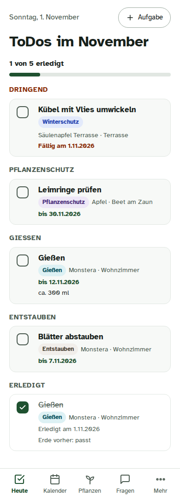
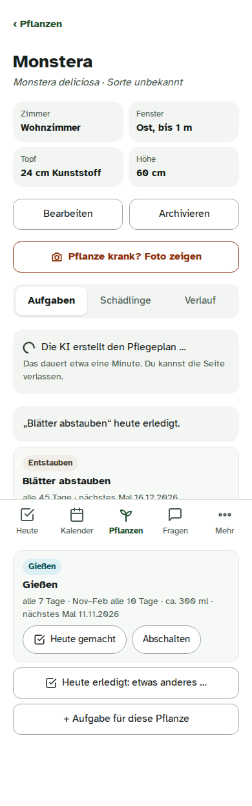
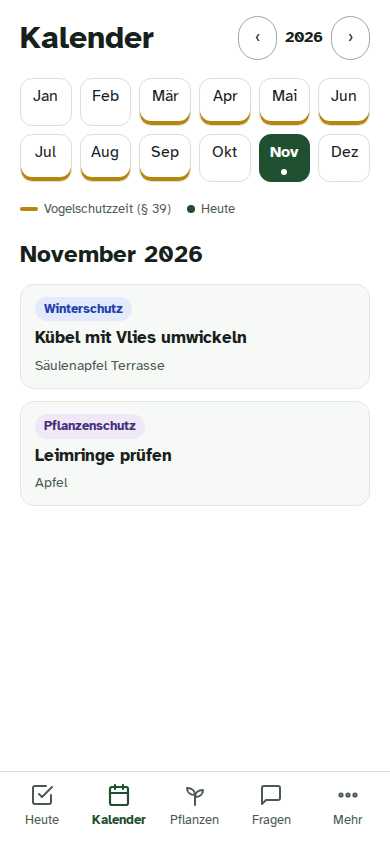

---
hide:
  - navigation
---

# Blattwerk

**A self-hosted plant planner for one household – for the garden and the indoor plants.**
You keep a list of your plants down to the cultivar; an AI writes a care plan for each one; Blattwerk turns the
plans into to-dos that follow the *real* season, warns before frost and heat, and helps when a plant looks sick.
The app is German (it is built for a household in Germany: German law, DWD weather); this documentation is English.

{ width="240" }
{ width="240" }
{ width="240" }

## In one minute

- **Plants and places.** Beds, hedge, tubs and greenhouse outside; rooms inside with the directions their windows
  face. German or Latin names, typos welcome – or identify a plant from a photo.
- **Care plans by AI, checked by code.** Pruning, fertilising with product examples, harvest, winter protection,
  pests; indoors watering (rhythm *and* amount), misting, dusting. Pruning law (§ 39 BNatSchG) is enforced in code.
- **To-dos that follow nature.** "Prune the roses when the forsythia blooms" – using the German weather service's
  phenology reports for your region, or your own observation.
- **Weather alerts with actions.** Frost, late frost on blossom, heat, storm – per plant and its hardiness.
- **Ask your garden.** A chat that knows your plants, to-dos, weather and season; a plant doctor for photos.
- **You decide.** The AI only proposes: nothing changes without your "Ja".

## Where to go next

- :material-sprout: **[Features](features.md)** – a tour through the app
- :material-sitemap: **[Architecture](architecture.md)** – containers, networks, data flows, diagrams
- :material-layers-triple: **[Tech stack](tech-stack.md)** – every part and why it was chosen
- :material-cog-play: **[How it works](how-it-works/index.md)** – the to-do engine, law, season, AI, chat
- :material-shield-lock: **[Security and privacy](security.md)** – threat model and what leaves the host
- :material-server: **[Self-hosting](self-hosting.md)** – run it on your own Docker host

